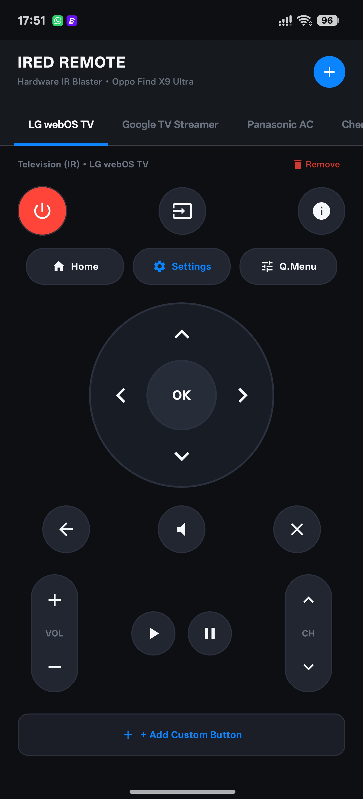
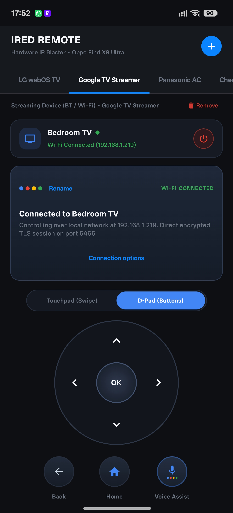
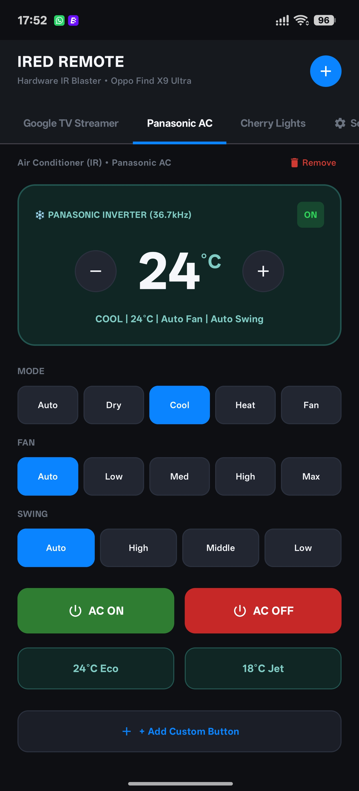
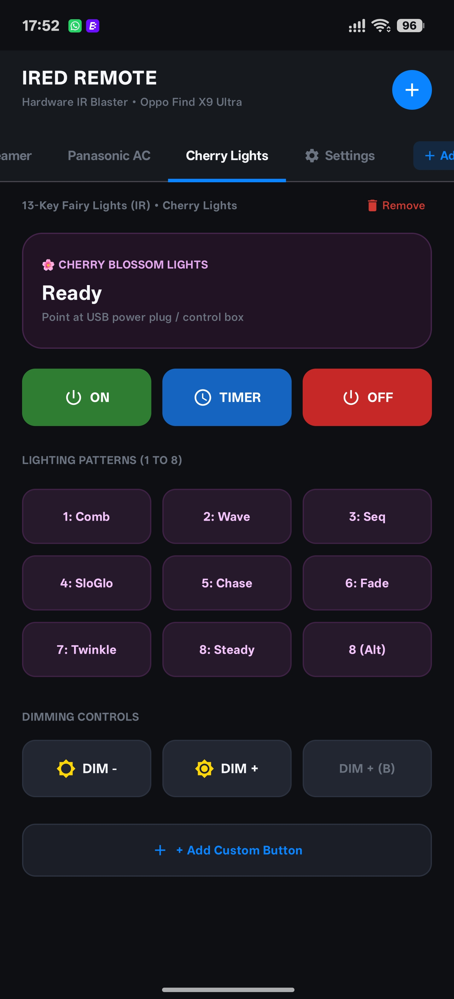

# iRed Remote

An Android remote-control app for IR appliances and Google TV devices. It is built with Kotlin and Jetpack Compose and stores remote profiles on the phone.

> **Device support:** IR controls need a phone with a consumer IR emitter. Google TV control uses the Android TV Remote service over the local network. This is an independent project and is not affiliated with Google, LG, Panasonic, or Cherry.

## Screenshots

### LG webOS TV



### Google TV Streamer



### Panasonic AC



### Cherry Lights



## Features

| Remote | Controls |
| --- | --- |
| LG webOS TV (IR) | Power, input, info, home, settings, Q.Menu, D-pad, back/exit, volume, mute, channel and media controls. |
| Google TV Streamer (Wi-Fi) | Discover on the local network or enter an IP, pair with the PIN on the TV, reconnect automatically using the saved pairing, cancel pairing, manage separate named Streamer profiles, and control with the D-pad or touchpad. Includes back, home, search key, playback and volume controls. The phone does not stream microphone audio. |
| Panasonic AC (IR) | Power, temperature, mode, fan and swing controls, plus custom buttons. IR sends are one-way; the app cannot confirm the AC received a command. |
| Cherry lights (IR) | Power, timer, lighting modes and dimming. |
| Custom IR remote | Add NEC buttons with a label and 32-bit code. |

The Google TV volume option can send volume commands through the LG TV's IR controls when HDMI-CEC is enabled and the LG TV is configured to control the Streamer's audio. It does not verify CEC state automatically.

## Install

1. Download the APK from the repository's [Releases](../../releases) page.
2. Open the APK on your Android phone. If Android asks, allow your browser or file manager to install unknown apps, then reopen the APK.
3. For IR remotes, point the phone's IR emitter at the device. For Google TV, keep the phone and Streamer on the same Wi-Fi network and approve the pairing PIN shown on the TV.

The minimum Android version is 8.0 (API 26). Network discovery can fail when the router isolates Wi-Fi clients or the device is on a guest network; entering the Streamer's IP is an alternative.

### Google TV pairing and reconnecting

Pair each Streamer once by approving its on-screen PIN. iRed saves the device address and pairing status, and keeps its client key in Android Keystore. When you reopen that remote, it reconnects automatically; it does not ask you to pair again. The phone and Streamer must be on the same reachable Wi-Fi network. If the Streamer's IP address changes or it is asleep when iRed tries to connect, use **Scan Wi-Fi** or **Change IP** and reconnect. **Disconnect** closes the current session; **Unpair Device** removes the saved pairing.

## Build from source

### Requirements

- Android Studio, or JDK 21 and the Android SDK platform/build tools for API 35.
- Internet access for the first Gradle dependency download.

The Android Gradle Plugin and Kotlin versions are defined in `gradle/libs.versions.toml`. Local SDK paths belong in the ignored `local.properties` file and are not committed.

### Build and install a debug APK

```sh
./gradlew assembleDebug
```

The APK is written to `app/build/outputs/apk/debug/app-debug.apk`. Connect a phone with USB debugging enabled and install it with:

```sh
adb install -r app/build/outputs/apk/debug/app-debug.apk
```

## Extend iRed

### Add a TV or other remote

The remote selector and device models are in `ui/screens/HomeScreen.kt` and `model/DeviceModels.kt`. Existing control pages are in `ui/screens/`; commands are dispatched through `ui/viewmodel/MainViewModel.kt`.

For a new IR device:

1. Add a protocol encoder under `ir/protocols/` (or extend `NecProtocol.kt` for NEC devices).
2. Add a page under `ui/screens/` using the shared button components in `ui/components/RemoteButtons.kt` and `VirtualDpad.kt` where appropriate.
3. Add a remote model/profile and connect the selector to the new page.
4. Keep protocol state encoding separate from Compose UI so it can be checked independently. Only claim support after testing commands on the real device.

For another Android TV / Google TV device, start with `gtv/GtvManager.kt`, `GtvWire.kt`, and `GtvCrypto.kt`. The Remote v2 pairing protocol uses TLS and protobuf-style messages; avoid changing wire or certificate handling based on guesses. Check the target device's Android TV Remote service and test pairing, reconnect, cancellation, and commands on hardware.

### Change button layout

Each remote's Compose page defines its control arrangement. Edit the rows, columns, spacing, and button sizes in the corresponding file under `ui/screens/` (for example `LgTvScreen.kt` or `PanasonicAcScreen.kt`). Shared round buttons and the D-pad live in `ui/components/`. Keep button callbacks connected to the existing `MainViewModel` command methods so layout edits do not change protocol behavior.

### Data and persistence

Remote models are in `model/DeviceModels.kt`; preferences and saved remote profiles are handled by `data/AppPreferences.kt` and `data/RemoteRepository.kt`. Use those paths when adding persistent names, custom controls, or new device settings.

## Develop and publish your own releases

GitHub Actions builds and lints an APK for pushes to `main`, pull requests, and manual runs. A tag matching `v*` also creates a GitHub Release and attaches the APK. To publish a version:

1. Increase `versionCode` and update `versionName` in `app/build.gradle.kts`.
2. Commit and push the changes to `main`.
3. Create and push a version tag, for example:

   ```sh
   git tag v1.0.0
   git push origin v1.0.0
   ```

4. Open the repository's **Actions** tab and wait for **Android build and release** to finish. The APK appears in **Releases**.

For repeat installs that update without uninstalling, configure a stable signing key once. Create a private Android upload/release keystore and add these four values under **Repository → Settings → Secrets and variables → Actions → New repository secret**:

Create the key locally and keep the `.jks` file in a secure backup:

```sh
keytool -genkeypair -v -keystore ired-release.jks -keyalg RSA -keysize 2048 -validity 10000 -alias ired
```

On macOS, copy the Base64 value to the clipboard with:

```sh
base64 -i ired-release.jks | tr -d '\n' | pbcopy
```

Paste that into the `IRED_RELEASE_KEYSTORE_BASE64` secret, then enter the password and alias values as the other three secrets below.

| Secret | Value |
| --- | --- |
| `IRED_RELEASE_KEYSTORE_BASE64` | Base64 encoding of the `.jks` file |
| `IRED_RELEASE_STORE_PASSWORD` | Keystore password |
| `IRED_RELEASE_KEY_ALIAS` | Key alias |
| `IRED_RELEASE_KEY_PASSWORD` | Key password |

The workflow uses that key to sign release APKs when the secrets exist. Without them, it publishes a debug-signed APK; that is fine for a first install, but Android will require uninstalling it before installing an APK signed by a different key. **Never commit the keystore or passwords.** Back up the keystore securely: future app updates must keep using the same signing key.

## Project map

```text
app/src/main/java/com/ired/app/
  data/       Preferences and remote-profile persistence
  gtv/        Google TV Remote v2 transport, crypto and wire messages
  ir/         IR transmitter and device protocol encoders
  model/      Device and remote state models
  ui/         Compose screens, shared controls and theme
  MainActivity.kt
gradle/       Version catalog and Gradle wrapper
.github/      Android build and release workflow
docs/         Project documentation and screenshots
tests/        Google TV wire regression checks
```

## Known limits

- IR requires compatible hardware and has no acknowledgement channel.
- Google TV requires the local Android TV Remote service and network reachability; this app does not send microphone audio for voice input.
- The Android UI is portrait-oriented.
- Device compatibility and IR codes should be tested with physical hardware before a release.
